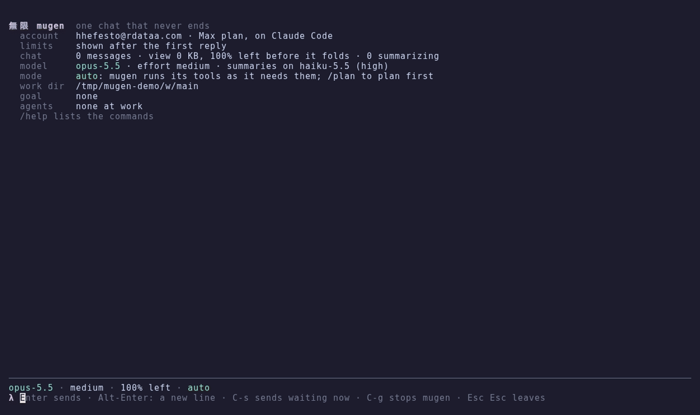

# mugen (無限)

One chat with an AI that never ends, in your terminal: *mugen* (無限) is
Japanese for "endless". It is Victor Taelin's
[UniiChat](https://github.com/VictorTaelin/uniichat) written in
[Bend 2](https://github.com/HigherOrderCO/bend).

Every message is logged verbatim, forever. A cheap model folds the log into a
binary tree of one-line summaries (at most 512 bytes each). Each turn is a
fresh API call that sees a 64 to 128 KB *view* of that tree, with recent
messages in detail and old ones coarse, and it `zoom`s into the tree whenever
it needs more. The chat runs tools on this computer (`shell`, `read`,
`write`, `edit`), starts subagents (`spawn`, `tell`), works toward a `/goal`,
and searches the web.

**[Read the guide](https://blog.hhefesto.com/mugen/guide.html)**: every key,
command and setting on one page, served by GitHub Pages from
[docs/guide.html](docs/guide.html).



## Run

mugen runs on one of two backends:

```sh
# On Claude Code's CLI (the default), signed in with a Claude plan
mugen login                          # once: runs `claude auth login`
mugen                                # or `nix run github:hhefesto/mugen`

# On the Messages API, with an API key
export ANTHROPIC_API_KEY=...         # curl reads it; it never appears in argv
mugen --api                          # or `nix run github:hhefesto/mugen -- --api`

mugen --version                      # e.g. `mugen 0.1.0`
```

mugen checks that Claude Code is signed in when it starts, and if it isn't,
says to run `mugen login`. If the sign-in lapses during a chat, run
`mugen login` in another window; the chat goes on with the next message.

- **Claude Code (default).** mugen drives the official `claude` CLI in
  headless mode (`claude -p`), so it runs on a Pro or Max plan's login.
  Anthropic allows plan logins only in its own apps, which is why mugen calls
  `claude` instead of reusing its login. Claude Code runs each call's tool
  loop, and mugen serves its own tools to it over MCP. The plan's usage limits
  apply, including to the summaries (one Haiku call each).
- **API (`--api`, or `MUGEN_WIRE=api`).** mugen calls the Messages API with
  curl and runs the tool loop itself, as UniiChat does.

**Caching.** Both backends send the same request layout: the system prompt,
then the view with one cache mark on its last whole 4-line block, then the
new message. The view only grows at its end between compactions, so each
turn reads the previous turn's prefix from the cache. On Claude Code the
marks last an hour. Claude Code's own context (CLAUDE.md, memory, git status)
is kept out of the prompt, so the prefix stays the same from call to call.

**Transcripts.** On Claude Code, a turn's, an agent's and a goal check's call
are each saved as a Claude Code session (`~/.claude/projects/`), and your
user-level hooks run on them. With `MUGEN_DEBUG_DIR` set, each such call also
writes a Claude Code debug log there.

Status: the tests run offline, against stand-ins for both backends (see
Develop). A short live chat has run on a Max plan through `claude -p`, with a
tool call and cache reads. The `--api` backend has not yet run against the
live API.

On a terminal mugen takes the whole screen (and gives it back as it was
when you leave). It opens with a status (the account, the plan's limits,
the chat and its view, the models, the mode, the work dir, the goal, the
agents) and the chat's last messages, so a restart shows where you were:

```
▸ edit  ~/notes.txt                                       +1 −1
  │ @@ -1,4 +1,4 @@
  │     1   one
  │     2 - tow
  │     2 + two
● Fixed: tow is now two.
──────────────────────────────────────────────────────────────
⠼ mugen works · 12s · ▸ shell 9s  nix build .#mugen
⧗ 1 waiting: «and run the tests after» · C-s sends now
opus-5.5 · medium · 87% left · auto
λ
```

Each entry is a block: your message (`❯`), mugen's reply (`●`, with a
little markdown), its summarized thinking (`✻`), and each tool call with
its result: the command or path asked, how it went (`✓ 0.4 s`,
`✗ exit 1`, `✂ cut`), its first lines of output, and for an edit or a
write the diff, with the file's line numbers, each line taken out on red and
each one added on green. Blocks come
open, whole: a click folds or opens one, `M-o` all of them (`C-o` too,
unless tmux takes it as its prefix). `PgUp`,
`PgDn` and the wheel scroll (`M->` follows the end again). Under the chat:
what runs and for how long (the tool too), the messages waiting for mugen,
the status line (where mugen works, the model, its effort, the context
left before mugen folds its oldest lines at 128 KB, the mode), and the
input.

Keys:
- `Enter` sends. While mugen works, the message waits, and says so, and
  `↑` on an empty input takes it back to edit (until mugen reads it, at
  its next tool call or its turn's end): only the version you send at last
  is logged and shown.
- `Alt-Enter`: a new line. That is the one that works everywhere;
  `Shift-Enter` and `C-j` reach mugen only where the terminal sends them
  apart from `Enter`, and many send them as a plain `Enter`. A paste comes
  whole, as one message.
- `C-s` (`/now`): send the waiting messages now. A shell command mugen is
  running is cut, and mugen gets its output and your messages; else its
  turn stops and one starts with them.
- `C-g` (`/stop`): stop mugen's turn.
- `Esc Esc`, `C-d`, `C-c` on an empty input (`/quit`): leave. `C-c` on
  text clears it (`C-y` brings it back).
- Emacs keys (`C-a`, `C-e`, `C-k`, `C-u`, `C-w`, `C-y`, `M-b`, `M-f`,
  `M-d`), the history (`↑`, `↓`, `C-p`, `C-n`, `C-r`, kept in
  `$MUGEN_DIR/history`), `Tab` completes a command.
- The mouse is mugen's: drag over the chat to select text (shown reversed;
  letting go copies it to the clipboard by xclip, and to tmux's buffer).
  `Shift`-drag is the terminal's own selection; `/mouse` hands the mouse
  to the terminal (and back).
- Agents: while subagents work, tabs follow the status line (`all`,
  `mugen`, each agent, `●` while it works). A click on one, or `M-←` /
  `M-→`, shows only that one's blocks (`all` is the whole chat again).

Commands:
- `/stop [name]`: stop the turn, or one agent.
- `/now`: as `C-s`.
- `/goal TEXT`, `/halt`: set a goal, or drop it.
- `/model opus-5.5|sonnet-5.5|haiku-5.5`, `/effort low..max`.
- `/plan`: mugen reads and proposes, changing nothing. `/auto` lets it act.
- `/image PATH` (or `/image` alone, for the clipboard's image, by xclip): the
  image goes with the message being written, as a line `[image
  docs/images/NAME]` in it (kept in `~/.mugen/docs/images/`). The turn's
  call sends the images its new messages name; `zoom(id, 1)` gives a
  message's images again, and `read` gives an image file whole (png, jpeg,
  gif, webp; 5 MB at most).
- `/status`, `/mouse`, `/tree`, `/export`, `/help`, `/quit`.

Whatever is running when you quit resumes at the next start. Leaving kills
every process the tools started; if mugen dies any other way, a watchdog
kills them within a second, and the next start kills whatever an earlier
one left, so no command outlives it.

In tmux it all works as is (the mouse and `PgUp` reach mugen whether
tmux's `mouse` is on or off). mugen turns tmux's `extended-keys` on as it
starts, unless set, so `Shift-Enter` can come apart from `Enter` if the
terminal under tmux sends it apart (many don't: use `Alt-Enter`). It names its window `mugen`, shows
`mugen …` while mugen works, and rings the window's bell when a reply comes
while you look at another window.

A data dir is one chat, and one mugen holds it: a second one on it says
where the first runs (its tmux pane) and stops. For a separate chat beside
it, give it another dir: `MUGEN_DIR=~/.mugen-2 mugen`.

`MUGEN_PLAIN=1` (or `TERM=dumb`, as in Emacs' shell) goes without the full
screen: lines as they come, a `λ` prompt, and a message of many lines
between two lines of `"""`. From a pipe (stdin not a terminal), each line
is a message, and mugen exits once stdin ends and nothing is running.

[The guide](https://blog.hhefesto.com/mugen/guide.html) (GitHub Pages, from
[docs/guide.html](docs/guide.html)) is a guide to all of it, a page that
opens in any browser.

## From your phone: Tailscale on NixOS

mugen is a terminal app, so a phone reaches it the way it reaches any
shell: over ssh or mosh, here through a private [Tailscale](https://tailscale.com)
network, with mugen kept running in tmux. Nothing opens to the LAN or the
internet.

On the NixOS machine, in its configuration:

```nix
{
  services.tailscale = {
    enable = true;
    openFirewall = true;                  # tailscaled's UDP 41641: direct links, not relays
    extraSetFlags = [ "--operator=you" ]; # you run `tailscale up/down/set` without sudo
  };

  services.openssh.enable = true;         # ssh itself (port 22)

  # mosh survives the phone sleeping and changing networks; its UDP ports
  # open on the tailnet only.
  programs.mosh.enable = true;
  programs.mosh.openFirewall = false;
  networking.firewall.interfaces.tailscale0.allowedUDPPortRanges = [
    { from = 60000; to = 61000; }
  ];

  users.users.you.openssh.authorizedKeys.keys = [ "ssh-ed25519 AAAA... phone" ];
}
```

Rebuild (`sudo nixos-rebuild switch`), then once:

1. `tailscale login` (or `tailscale up`), open the URL it prints, and sign
   in with the account the phone will use. If it answers "Access denied:
   checkprefs access denied", the operator isn't set yet: run
   `sudo tailscale set --operator=you`.
2. In the admin console (https://login.tailscale.com/admin/machines),
   approve the machine if it asks, and pick "Disable key expiry" from its
   `…` menu, so the login doesn't lapse in 180 days.
3. `tailscale status` lists the machine; its MagicDNS name is its hostname.

On the phone: the Tailscale app, signed in with the same account. Then an
ssh/mosh client (Blink on iOS, Termux on Android) whose public key is in
`authorizedKeys`: `mosh you@HOSTNAME`, `tmux new -A -s main`, `mugen`. The
next time, the same two commands find mugen where you left it, and a reply
that came meanwhile has rung tmux's bell. To land in tmux on every login,
add to your shell's init: `[ -z "$TMUX" ] && [ -n "$SSH_TTY" ] && exec tmux new -A -s main`.

`tailscaled` starts at boot and keeps the login; `tailscale down` and
`tailscale up` take the machine off the network and back.

## Settings (environment)

| Variable | Default | |
|---|---|---|
| `MUGEN_DIR` | `~/.mugen` | the chat: `main/`, `tree/`, `view.json`, agents' logs |
| `MUGEN_WORK` | `$MUGEN_DIR/work` | the tools' work dir, a dir per agent |
| `MUGEN_PICK` | `opus-5.5:medium:slow` | the chat's model, effort and speed |
| `MUGEN_COMPACTOR` | `haiku-5.5:high:slow` | the summaries' model |
| `MUGEN_RULES` | `$MUGEN_DIR/rules.md` | your instructions, appended to the system prompt |
| `MUGEN_JOBS` | `8` (`48` with `--api`) | summaries at once (each is a `claude` process on Claude Code) |
| `MUGEN_SYNC` | `1` | fsync each log write |
| `MUGEN_MAX_TOKENS` | `16000` | a reply's most tokens |
| `MUGEN_WEB_SEARCH` | `web_search_20260209` | the web search tool's type (`--api`) |
| `MUGEN_WIRE` | | `api`: the same as `--api` |
| `MUGEN_CLAUDE` | `claude` | the Claude Code CLI to run |
| `MUGEN_TRANSCRIPTS` | `chat` | which calls Claude Code saves as sessions: `chat` (turns, agents, goal checks), `all` (summaries too), `none` |
| `MUGEN_DEBUG_DIR` | | where each chat call's Claude Code debug log goes (none if unset) |
| `MUGEN_PLAIN` | | `1`: not the full screen (lines as they come, a prompt) |

The data dir is UniiChat's format (`users/<id>/` there), so either program
can open the other's chat.

## Develop

`nix develop`, then see [AGENTS.md](AGENTS.md) for the layout, the tests
(`nix flake check` runs them all, including a step-for-step differential
test against UniiChat's own `Memory.ts`), and the Bend 2 pitfalls that shaped
the code.

The demo at the top is a real Claude session: `nix run nixpkgs#vhs -- docs/demo.tape`
records it again into `docs/demo.gif`. Then hold its last scene for 8 seconds
before it loops (vhs can't set one frame's delay):

```sh
nix run nixpkgs#gifsicle -- -b docs/demo.gif '#0--2' -d800 '#-1'
```

## License

Apache 2.0, like UniiChat. mugen ports UniiChat's design and code to Bend 2
and carries its prompts verbatim (`bend/Prompts.bend`, generated from
UniiChat's `prompt.txt`).
